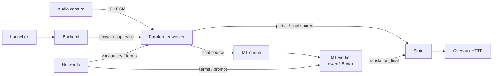
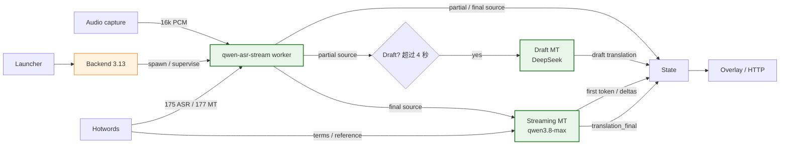

# 模块框图

两张图：一张是原来的 Paraformer 基线，一张是现在主推的 3.1 + reference 方案。
只画模块和数据流，不展开参数细节。

## 基线：Paraformer + qwen3.8-max

- 识别是流式的，但翻译是**整句阻塞**：拿到 `source_final` 才进 MT 队列。
- 原文 partial 先上屏，译文要等 MT 返回。
- 热词分两路：ASR 的 vocabulary、MT 的术语表/prompt。

## 主推：qwen3.1 + reference + 流式翻译/草稿

绿色 = 新增模块；橙色 = 运行时变化（backend 改用 Python 3.13，解决 3.1 连接掉线）。

## 模块与数据

| 模块 | 输入 | 输出 | 新增？ |
|---|---|---|---|
| Launcher | 用户设置、API Key | 启动参数 | 否 |
| Backend | 启动参数、音频 | 子进程管理、事件解析 | 运行时换成 3.13 |
| Audio capture | WASAPI / Edge 音频 | 16 kHz mono PCM，100 ms/帧 | 否 |
| qwen-asr-stream worker | PCM + vocabulary | partial/final source | **是** |
| Streaming MT | final source + 术语 | 首 token / SSE delta / final | **是** |
| Draft MT | 超过 4 s 的 partial | `draft=true` 译文 | **是** |
| State / Overlay | 所有 result 事件 | 字幕条目、悬浮窗/HTTP | 否（扩展了 provisional 事件） |
| Hotwords | 词表/术语卡 | ASR vocabulary、MT terms | 否（3.1 上限 175） |

## 模块间传的东西

| 路径 | 内容 |
|---|---|
| capture → ASR | 16 kHz mono PCM，100 ms 一帧 |
| ASR → State | `sentence_id`、`source`、`begin_time`、`end_time`、`source_final` |
| ASR final → MT | 原文 + 本句命中的术语 |
| MT → State | `translation` 增量（`translation_final=false`），最后一条 final |
| Draft → State | `draft=true`、同一 `sentence_id`；final 到达后覆盖 |
| State → Overlay | `chunk`、`source`、`translated`、`final` |

## 和基线的差异

| 层 | 基线 | 3.1 主推 |
|---|---|---|
| ASR | Paraformer realtime | qwen3.1 streaming，near-field VAD，200 ms |
| 热词 | Paraformer vocabulary + MT 术语 | 175 条 ASR vocabulary + 177 条 MT 术语 |
| 翻译 | qwen3.8-max，整句阻塞 | qwen3.8-max，reference + SSE 流式 |
| 长句 | 等终句 | 4 s 草稿先上屏，终句覆盖 |
| 运行时 | Python 3.10 backend | Python 3.13 backend |
